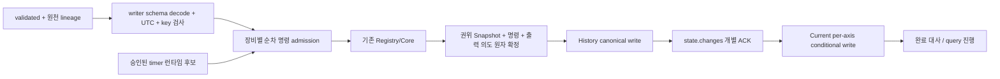

# Phase 4 — Spark Job 4 및 운영 Sink 통합 실행 계약

작성일: 2026-10-23 (Asia/Seoul). 상태: **설계 전용·실행/인프라 미승인**.
현재 .venv에는 PySpark가 없다. 이 배치에서 Spark를 설치·실행하지 않았다.
[로컬 Application 보고서](../reports/phase-4-local-application.md),
[출력 계약](state-output-contracts.md), [Health 계약](equipment-health-contracts.md),
[플랫폼](../architecture/platform.md), [Kafka](../architecture/kafka-topics.md),
[복구](../operations/late-events-and-backfill.md)를 함께 따른다.

## 1. 현재 연결과 운영 경계

현재 LocalStateApplication은 validated numeric mapping → 기존 Health/Operational
Registry → Core 결과 → Envelope/Current-only 의도 → SQLite root+command+intent → Fake
reconcile 경로를 실행한다. LocalHealthTimers는 명시 token/평가 시각으로 같은 저장 경계를
사용한다. Operational/Health는 독립 축이고 두 축 동시 호출은 재개 가능하지만 단일
cross-axis transaction이 아니다. 기존 장비/FSM/Health 판정은 변경하지 않는다.

Numeric Fryer는 Health만 계산한다. Fryer Operational synthetic 신호는 로컬 검증용
별도 process_signal 경로다. 실제 validated Avro에 mode/cleaning/fault가 있다고 가정하지
않는다. Hood는 동일 RPM을 두 축에 명시 전달하며 후보/health 원장을 공유하지 않는다.
Refrigerator/Freezer/Dishwasher fallback은 없다. Source 권한·timeout은 운영 승인 전이다.

그림의 L은 운영 저장소가 정해졌다는 뜻이 아니다. SQLite는 로컬 모델이며 executor별
파일로 복제하거나 network filesystem에 두는 것을 운영안으로 채택하지 않는다.

## 2. validated 입력과 decode 경계

- 입력 topic은 kitchen.sensor.validated, key는 equipment_id다. source topic/partition/
  offset/Kafka timestamp와 수신 시각은 numeric 10필드 밖의 별도 lineage로 보존한다.
- 기존 Phase 2 decode_sensor_event/parse_confluent_frame과 UTC 정규화 규칙을 재사용할
  수 있다. schema ID별 writer schema/cache·executor 접근·인증·미지원 schema 처리는
  실제 adapter에서 검증한다. latest schema 임의 선택/자동 등록은 금지한다.
- decoded event는 event_id/event_time/store/equipment/type/metric/value/unit/version/source
  10필드여야 한다. Local Application은 datetime 또는 offset 있는 ISO 문자열을 UTC로,
  metric_value를 물리 Avro double에 맞게 float로 정규화한다. bool/nonfinite는 거부한다.
  이것은 Job 2의 모든 품질·late·Silver 검증을 다시 수행하거나 대체하는 것이 아니다.
- Kafka key/payload identity 검사는 runtime ingress 책임이다. 현 local mapping API에는
  raw input key/offset 인자가 없으므로 실제 Kafka 입력 검증 완료 증거가 아니다.
- 입력 계약 오류와 일시적 Registry/저장/권한 장애를 구분한다. 오류를 catch-and-skip하고
  뒤 이벤트를 유효한 연속 후보로 처리하지 않는다. 현재 Registry는 admission 거부 시
  snapshot을 그대로 보존하므로, quarantine/후보 단절 handoff 정책을 닫기 전에는 해당
  순차 처리를 실패 유지한다. 자동 후보 reset/새 오류 정책을 임의 도입하지 않는다.

## 3. micro-batch와 순서 책임

1. schema decode·등록 identity/profile/source/key를 검사한다. batch_id는 감사 근거이며
   상태 변경 ID나 유일 명령 ID를 대체하지 않는다.
2. 같은 장비의 원천 전달 순서를 명시한다. 단일 validated topic/key/고정 partition 아래
   partition offset 순서가 후보이며, 입력 경로가 여러 개라면 승인된 per-device 명령
   ordinal이 필요하다. DataFrame collect/group 순서에 기대지 않는다.
3. event_time으로 몰래 정렬하지 않는다. 기존 Core는 명령 순서에서 역순/동시각을
   거부하며 timestamp 정렬은 수용 이력을 바꿀 수 있다. 현재 로컬 앱은 caller 순서다.
4. 동일 명령 재시도에는 최초 기록된 평가 시각·input을 사용한다. processing_time을
   매 재시도 다시 읽어 Health age/timeout 판정을 바꾸지 않는다. 신규 명령 수용 시각과
   replay 시각을 분리하고 admission·순번 발급·snapshot CAS 프로토콜을 검증한다.
5. 장비/축의 exact-policy Snapshot을 로드하고 기존 계산을 호출한다. Snapshot/명령/
   출력 의도를 함께 확정한 뒤 Sink별 처리한다. 부분 축 commit은 해당 command 재실행으로
   남은 축을 완료하며, 이전 축을 다시 적용하거나 최신 Snapshot으로 되감지 않는다.
6. 기본안은 모든 필요한 Sink가 ACK/검증된 superseded가 된 뒤 batch 성공이다. 오류를
   정상 반환하여 checkpoint만 진행시키지 않는다. 처리량 때문에 async dispatcher를
   쓰려면 durable 소유권/scan/완료 계약을 먼저 승인한다.

파티션 증설·key namespace 변경·둘 이상의 입력 topic은 순서 재검증 조건이다. source
offset 순서도 event_time 순서나 두 축 전체의 원자적 조회 순서를 보장하지 않는다.

## 4. state 권위와 query/checkpoint 선택지

| 선택지 | 장점 | 해결되지 않은 조건 | 현재 상태 |
|---|---|---|---|
| Spark stateful operator + 외부 publication ledger | native state/timer/checkpoint 활용 | state와 외부 의도의 원자성 없음; 중간 유실·중복 복구 필요 | runtime 검증 전 후보 |
| foreachBatch + 외부 권위 state/command/outbox | 로컬 모델의 CAS/의도 경계를 유지 가능 | 운영 저장소·순서·분산 writer·admission atomicity 필요 | 비교 권장, 저장소 채택 아님 |
| Spark 출력 의도를 checkpoint 가능한 durable 경로에 먼저 저장 | 전달과 계산 경계 분리 가능 | 저장 프로토콜·중복 ID/epoch/로그 완전성 검증 필요 | 대안, 경로/기술 미정 |

Job 4는 Job 1/2/3와 다른 query/checkpoint를 사용해야 한다. 이번에 경로나 Job 파일을
만들지 않았다. 실제 stateful API·output mode·operator topology를 정한 뒤 query 수와
checkpoint schema를 고정한다. 논리 Job 4를 유지하되 별도 consumer/worker 도입은
운영 책임·장애 격리를 검토하는 별도 결정이다. Phase 5 기능은 이번 설계에서 제외한다.

공식 Spark 4.0 문서는 foreachBatch의 기본 전달 보장을 at-least-once로 설명한다.
외부 3개 저장소까지 exactly-once라고 확장하지 않는다.
[공식 Guide](https://spark.apache.org/docs/4.0.0/streaming/apis-on-dataframes-and-datasets.html).

## 5. event-time·평가 시각·timer 런타임

Health last_seen은 수용 event_time, deadline은 그 시각+명시 timeout이다. 무관측 boot는
명시 start+timeout이다. evaluation_time>=deadline에서 STALE이며 token의 epoch/profile/
generation/deadline을 검사한다. 현재 앱은 실제 시계를 읽거나 자동 tick을 발행하지 않는다.

| Timer 후보 | 검토 사항 | 채택 조건 |
|---|---|---|
| Spark processing-time timer | idle·restart·expired callback 및 현재 generation 연결 | 대상 DBR/PySpark API/권한/실제 무입력 동작 검증 |
| 별도 durable scheduler/tick 명령 | 입력과 같은 권위 state/CAS에 직렬화 가능 | 예약/ACK/소유권/재시도·query 종료 lifecycle 설계 |
| processing trigger만으로 scan | 구현이 단순해 보임 | 무입력 foreachBatch 실행을 가정하지 않음; 실행 보장 실측 전 제외 |
| event-time/watermark만 | event-time 연산과 자연스럽게 연결 | 무입력 시 freshness 만료 보장 불가이므로 단독안 제외 |

Spark 4.0 공식 문서에는 Python transformWithStateInPandas와 timer callback/checkpoint
기능이 있다. 이는 KTD 대상 runtime에서의 지원·idle callback·운영 적용 증거가 아니다.
[TransformWithState 공식 문서](https://spark.apache.org/docs/4.0.0/streaming/structured-streaming-transform-with-state.html).

Native timer의 millisecond 시각과 현재 μs UTC 계약의 경계 변환/올림·경계 오차는
구현 전 별도 결정/검증한다. 임의 timestamp 절삭으로 deadline 직전 STALE을 만들지 않는다.
같은 시각 tick→관측은 STALE→HEALTHY, 관측→옛 tick은 무효라는 기존 이력을 유지한다.
두 순서를 합치거나 타이머를 무조건 먼저/나중으로 정하지 않는다. 명령 순서를 기록한다.

## 6. Snapshot과 checkpoint 불일치 복구

| 상태 | 복구 요구 |
|---|---|
| authority Snapshot/의도 확정, Spark checkpoint 지연 | 같은 명령은 cached 결과/의도를 재사용; 최신 state를 오래된 batch로 덮어쓰지 않음 |
| Spark checkpoint 진행, 의도 누락 | 허용 불가 경계. 원자적 확정/내구성 증거 없이 batch 성공 금지 |
| Snapshot만 저장·의도 실패 | 로컬 모델은 transaction rollback. 운영안도 동등 경계가 없으면 통합 보류 |
| Sink ACK 성공, ACK 기록 유실 | UNKNOWN으로 대사/재시도; Kafka 중복 허용, History/Current 멱등 방어 |
| checkpoint/state 유실 | 일반 restart 아님. 보존 입력/명령/원장/정책을 확인한 승인된 State Rebuild |
| profile/schema/operator topology 변경 | exact-policy 거부 또는 승인 migration/replay/cutover; 기존 checkpoint 재사용 자동 가정 금지 |

Operational Codec은 operational-snapshot-v1, Health Codec은 기존 version을 사용한다.
직전 배치의 opaque Operational image는 새 앱에서 자동 migration하지 않는다. 남아 있는
pending publication은 기존 canonical bytes로 대사할 수 있지만 신규 상태 처리를 위해
snapshot을 임의 재생성하지 않는다. 실제 데이터 이관은 별도 승인 후 진행한다.

## 7. writer fencing·multi-dispatcher

운영 generation은 승인된 control authority가 발급하고 Snapshot/명령/의도/Current에
묶어야 한다. 문자열 epoch·wall-clock·UUID 정렬로 writer 우선순위를 만들지 않는다.
로컬 fixture generation=1은 권한 승인 체계의 구현이 아니다.

계산 writer는 before revision CAS와 lease/fence를 함께 검사해야 한다. dispatcher는
출력/장비별 claim·lease·attempt 번호를 사용하고 ACK 유실을 재획득으로 처리해야 한다.
현재 모델은 attempt 번호로 늦은 ACK를 막지만 다중 dispatcher의 소유권·lease·순서
보장을 구현하지 않는다. 임의 병렬 worker로 같은 장비를 동시에 재전송하지 않는다.
운영 저장소 transaction/conditional update 지원과 unique conflict 동작이 선행 게이트다.

## 8. 운영 Sink 계약과 재처리

| 경계 | 요구 | runtime에서 확인할 내용 |
|---|---|---|
| Iceberg History | (axis,native ID) canonical 불변, 같은 payload no-op/다르면 conflict | 실제 catalog/table/DDL, 지원 insert/MERGE/unique·writer 경합·commit/read-back |
| Kafka state.changes | equipment_id key, 고정 writer schema/bytes, callback/offset ACK | v1 초안 등록·subject/BACKWARD·reader 배포, IAM/broker/producer 설정·ACK 유실 |
| DynamoDB Current | generation/context+축별 projection revision CAS, 낮으면 superseded | 실제 expression/consistent read/초기화/중복·경합/정책 cutover |

현재 [StateChangeEvent 초안](../../schemas/avro/state_change_event.avsc)은 설치 라이브러리로
오프라인 호환성/왕복만 검증했다. 실제 Schema Registry 등록 상태나 consumer 호환성은
확인하지 않았다. numeric sensor schema/subject는 변경하지 않는다.

UC Managed Iceberg의 일반 지원을 특정 History table의 MERGE/unique 보장으로 간주하지
않는다. 기존 Bronze를 변경하지 않고 운영 runtime에서 검증해야 한다.
[Databricks 공식 문서](https://docs.databricks.com/aws/en/iceberg/).
History-first가 성공해도 topic/current의 완료는 별도다. same native ID의 다른 payload는
자동 overwrite/re-ID하지 않는다. 같은 Health timeout ID의 evaluation_time도 최초 확정
명령의 것을 재사용한다. 일반 backfill은 Current를 바꾸지 않으며 승인 State Rebuild만
cutover한다. 최신 Current 뒤 옛 replay가 와도 revision/세대 조건으로 되감기를 방지한다.

## 9. 비용·권한·리소스 실행 게이트

현재는 public 공식 문서 조회와 로컬 테스트만 했다. AWS/DBR/Confluent API/compute,
실제 topic/DDL/Sink 쓰기를 실행하지 않았다. 운영 Outbox 저장소도 선택하지 않았다.

유료 실행 전에 대상 runtime/version, query/cluster 최대 실행 시간·중단/정리 방법,
DBU/VM/스토리지/요청/네트워크 비용과 승인 예산, 리소스별 IAM·UC·Registry 권한을
확인해야 한다. endpoint/role/schema/table/checkpoint 실제 식별자와 retention/backup·
롤백 조건이 없으면 실행하지 않는다. 예산·성능·복구 SLA 수치를 임의 보장하지 않는다.

## 10. 다음 구현 진입 조건

1. source/Operational typed 신호 권한·Health timeout·admission 오류 handoff를 확정한다.
2. 목표 DBR/PySpark와 state 권위/원자적 의도 전략을 선택한다. SQLite를 운영 DB로
   옮겨 놓는 것으로 완료하지 않는다.
3. 승인된 로컬 Spark 환경에서 입력 무순서·idle·재시작·동일 명령 replay·timer 경합을
   먼저 검증한다. 현재 .venv에 설치를 추가하지 않았다.
4. 새 state wire schema/reader 호환성·History 방식·Current conditional 계약을 닫는다.
5. 유료 자원/권한/비용·정리 계획 승인 후 최소 smoke와 세 Sink failure 실측을 진행한다.
6. query/stateful topology 또는 checkpoint schema 변경에는 명시 migration/cutover 절차를
   적용한다. 기존 checkpoint를 삭제/초기화하지 않는다.

이 문서 완료는 Job 4/운영 Sink 구현 완료 또는 Phase 4 전체 DoD 충족을 뜻하지 않는다.

## 11. Concurrency / Fencing runtime 재감사 — 2026-10-23

이 절은 앞선 미구현 표현 중 **선택적 로컬 v2 경로**만 갱신한다.
[동시성 계약](state-concurrency-contracts.md)과
[실측 보고서](../reports/phase-4-concurrency-recovery.md)를 따른다. 기존 v1 entry point는
자동 전환하지 않으며, 운영 저장소나 leader election을 선택한 것이 아니다.

### 지원 API 확인과 실제 설치 환경

현재 Python 3.11.15 / SQLite 3.50.4 / pytest 9.1.1 / fastavro·avro 1.12.2 /
confluent-kafka 2.15.1이다. importlib.metadata로 PySpark **미설치**를 확인했다.
Spark 실행·설치·DBR Workspace 접근은 수행하지 않았다. DBR 대상 version은 미확정이다.

2026-10-23 공식 문서 확인:

| 문서상 후보 | 확인된 API·제약 | KTD에서 남은 검증 |
|---|---|---|
| Spark 3.5.6 Python | applyInPandasWithState 문서에 state/timeout API 존재 | target DBR 매핑, Python/Pandas/Arrow 의존성, timeout·restart 실측 |
| Spark 4.0.0 | transformWithStateInPandas / StatefulProcessor, EventTime·ProcessingTime, timer checkpoint/restart 지원 설명 | target DBR 지원·idle callback·state schema·μs↔ms 경계·순서 실측 |
| Spark 4.0.0 foreachBatch | 기본 at-least-once, continuous processing 미지원; 여러 action은 재계산 가능 | microbatch replay+외부 권위 원자성·각 Sink ACK·batch 실패 전파 |

[3.5.6 applyInPandasWithState 공식 API](https://spark.apache.org/docs/3.5.6/api/python/reference/pyspark.sql/api/pyspark.sql.GroupedData.applyInPandasWithState.html),
[4.0.0 TransformWithState](https://spark.apache.org/docs/4.0.0/streaming/structured-streaming-transform-with-state.html),
[4.0.0 foreachBatch Guide](https://spark.apache.org/docs/4.0.0/streaming/apis-on-dataframes-and-datasets.html#using-foreach-and-foreachbatch).
위는 API 존재 근거이며 최신판 권장·KTD runtime 호환 확인이 아니다. latest/Python 단독
foreachBatch 페이지는 이번 조회에서 접근되지 않아 열람 가능한 version 고정 Guide를 썼다.

### Driver / Executor와 상태 권위

- foreachBatch callback의 driver 조정과 DataFrame action의 executor 작업을 구분한다.
  executor retry/speculation/task 재실행은 side effect를 반복할 수 있으므로 partition/task
  ID를 명령 identity나 writer authority로 삼지 않는다. driver 메모리/로컬 파일만으로
  distributed CAS를 제공하지 않는다. 순수 Core와 sink client 생성/권한 수명을 분리한다.
- source partition offset 또는 승인된 장비 ordinal로 순서를 명시하고 같은 장비의 서로
  다른 명령을 한 authority에서 admission한다. shuffle iterator 순서·event_time sort·
  batch_id 단독 dedup에 의존하지 않는다. 로컬 장벽은 도착 전 원천 명령의 순서를 모른다.
- runtime snapshot/checkpoint와 권위 command/intent 사이의 commit protocol을 확정해야
  한다. Spark state와 외부 SQLite를 원자 commit했다고 해석하지 않는다. 의도 확정 전
  query checkpoint 성공·error catch-and-skip은 허용하지 않는다. retry는 최초 평가 시각을
  복원해야 한다. native timer checkpoint만으로 sink ACK나 pending이 복구되는 것은 아니다.
- event-time/watermark 단독은 무입력 STALE을 보장하지 않는다. processing-time callback
  또는 durable tick 런타임을 별도 채택·검증한다. deadline 경계와 generation 무효화는
  Core에 맡기고, 관측/tick 경합 순서를 원장에 보존한다. 자동 wall-clock 재계산은 금지한다.

### 로컬 모델을 운영으로 옮길 때의 변경

| 책임 | 이번 로컬 구현 | 운영 선행 게이트 |
|---|---|---|
| writer 발급 | 명시 acquire_writer, SQLite epoch CAS | 승인 control authority, 인증, failover/lease/관리 권한·장비 소유권 |
| root/장벽/의도 | 새 v2 한 파일 transaction+savepoint, 축별 완료 | 승인 transactional authority의 동등 원자성·CAS·장비 장벽; storage 기술 미선정 |
| dispatcher | output claim/expiry/sequence, 명시 clock, bounded scan | 분산 clock/lease 연장·보수적 expiry·partitioned scan·권한·재시도 예산·관측성 |
| History | Fake immutable key/body/chain | target Iceberg의 실제 canonical write/경합/중복 검출/권한·실패 실측 |
| Kafka | ACK 유실 시 Fake 중복 append | canonical Avro bytes/schema ID 영속 pinning, producer ACK/timeout/restart/중복 소비 검증 |
| DynamoDB Current | Fake per-axis conditional revision | 실제 UpdateItem 조건식·다른 축 보존·superseded read-back·동시 쓰기/오래된 요청 실측 |
| 복구 | Snapshot+intent+admission+claim 파일 reopen | 보존/백업·복제·점검·복원·state rebuild·checkpoint와 권위 로그 대사 |

SQLite 파일을 executor마다 복제하거나 network filesystem에 공유하는 운영안을 승인하지
않는다. output lease는 외부 Sink 쓰기 차단 토큰이 아니며, 늦은 sender의 Kafka 중복이
가능하다. 장비별 Current는 revision으로 보호하고 History는 key/body를 대조해야 한다.
claim/release/ACK는 세 Sink를 하나의 transaction으로 만들지 않는다.

### Job 4 실행 전 필수 승인과 증빙

1. 대상 DBR/PySpark/JVM/Pandas/Arrow/API·state topology·timer 방식과 새 checkpoint 경로를
   확정한다. 기존 checkpoint 변경/삭제·state schema migration은 별도 승인한다.
2. authority 저장소/소유권 발급·장비 순서/전체 명령 장벽·취소/invalid 입력·보존 정책을
   결정한다. 운영 timeout/source/fault 권한은 미확정이며 fixture 숫자를 전용하지 않는다.
3. Snapshot/command/intent commit과 Spark progress의 실패 행렬을 실제 runtime에서 검증한다.
   driver/executor 재시도·speculation·failover·중간 축 종료·동일 batch replay가 포함된다.
4. Registry subject/name·writer schema ID·compatibility mode·인증/egress·consumer version을
   승인하고 실제 Registry 조회/등록은 범위별 별도 승인 후 한다. offline Avro round-trip은
   실제 subject 호환성/Registry 가용성 증거가 아니다. 자동 latest/자동 등록은 없다.
5. History/topic/DynamoDB의 실제 자원명·최소 IAM/credential·network·비용·중단/정리 절차를
   승인한다. 3개 Sink의 부분 실패, ACK 유실, stale writer/dispatcher를 실측한다.
6. Phase 2/3 선행 병합, 전체 Phase 4 DoD·운영 승인·사용자 검토 전 main merge/배포 금지다.

이번에 1~6의 유료/외부 실행은 하지 않았다. 현재 선행 게이트는 열린 상태다.

## 12. Git Reconciliation & Readiness Audit — 2026-10-23

최신 판단은 [정합성 감사 보고서](../reports/phase-4-readiness-audit.md)를 따른다.
11절의 API 존재 확인과 실제 실행 가능 여부를 이번 설치 환경으로 다시 구분했다.

| 확인 항목 | 실제 관측 | 판정 |
|---|---|---|
| Python | 3.11.15 | Spark 3.5.6의 Python 3.8+, Spark 4.0.0의 Python 3.9+ 범위 안. runtime 호환 실증은 아님 |
| PySpark / spark-submit | package·import spec 없음 / 실행 파일 없음 | Spark Runtime 미설치, 실행 불가 |
| pandas / pyarrow | 둘 다 미설치 | Python stateful Pandas API 의존성 준비 안 됨 |
| Java | /usr/bin/java -version: Java 24, exit 0 | 아래 두 Spark 문서의 지원 목록 밖. 승인된 JDK/runtime 조합 필요 |
| Spark 3.5.6 문서 | Java 8/11/17, Python 3.8+ | version 고정 문서의 명시 범위; DBR target 미확정 |
| Spark 4.0.0 문서 | Java 17/21, Python 3.9+ | version 고정 문서의 명시 범위; DBR target 미확정 |
| Job 4 파일 | streaming/jobs에는 raw_ingestion/sensor_validation_job/runtime_config만 존재 | State Job entry point 미구현 |

[공식 Spark 3.5.6 환경](https://spark.apache.org/docs/3.5.6/index.html),
[공식 Spark 4.0.0 환경](https://spark.apache.org/docs/4.0.0/index.html)을 직접 대조했다.
Java -version 조회는 Spark Job 실행이 아니다. 환경 설치/변경·Workspace 조회는 하지 않았다.

현재 Job 2 validated publisher는 기존 SensorMetricEvent 10필드·metric_value double·
aware UTC ISO string·equipment_id UTF-8 key를 유지한다. Silver 성공 후 Kafka 실패나
checkpoint 이전 종료 시 중복이 가능하므로 Job 4는 event_id/payload 판정을 재사용한다.
mode/cleaning/fault는 wire에 없고 source Kafka partition/offset은 별도 lineage다.
caller admission 순서와 실제 partition offset 순서를 연결하는 runtime ingress는 미구현이다.

foreachBatch 기본 at-least-once·continuous mode 제외, stateful timer checkpoint 설명은
[공식 streaming Guide](https://spark.apache.org/docs/4.0.0/streaming/apis-on-dataframes-and-datasets.html)와
[공식 TransformWithState](https://spark.apache.org/docs/4.0.0/streaming/structured-streaming-transform-with-state.html)를
재확인했다. API 존재는 확정, DBR 배포/API 및 무입력 timer callback·restart 동작은 검증 필요다.

추가 운영 Blocker:

- 같은 파일 v1/v2 혼용은 거부하지만 **독립 DB의 같은 장비에는 공통 fencing이 없다**.
  런타임은 장비별 단일 authority 및 v1→v2 명시 cutover를 강제해야 한다. SQLite lease를
  다중 호스트 권한으로 해석하지 않는다. control service/지원 transactional store 또는
  검증된 Spark state 권위를 비교할 수 있으나 이번에 하나를 채택하지 않았다.
- pending=0은 전체 명령 완료를 뜻하지 않는다. ADMITTED/PARTIAL과 CONFLICT, 각 Sink ACK를
  함께 대사해야 한다. invalid admitted 명령 취소·수정·quarantine/후보 단절 정책을 정하기
  전에는 자동 skip하지 않는다. bounded pass 성공/빈 결과를 query 전체 성공으로 사용하지 않는다.
- Snapshot/command/intent와 Spark checkpoint 사이 원자성, canonical Avro bytes/schema ID
  pinning, 운영 History/Kafka/DynamoDB 전달은 미구현이다. 별도 저장소를 확정하지 않는다.
- 새 Job 4 checkpoint는 승인된 고유 경로로만 생성한다. 현재 query/checkpoint를 탐색·수정·
  삭제하지 않았다. topology/state schema/profile 변경 시 호환성 검증이나 승인 cutover가 필요하다.

Job 4 진입 우선순위는 runtime/JDK와 state 권위·명령 실패 처리 정책 결정 → 승인된 오프라인
runtime contract harness → 실제 자원·권한·비용 승인 → 3 Sink E2E다. 이번에는 후속 구현을 시작하지 않는다.
